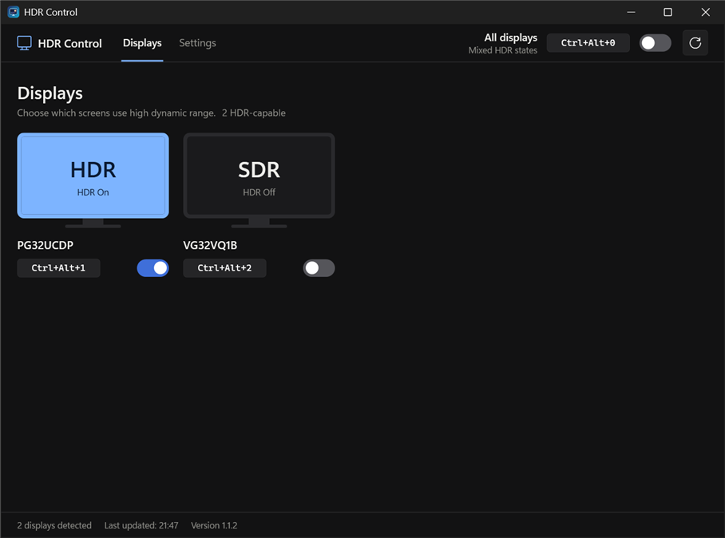
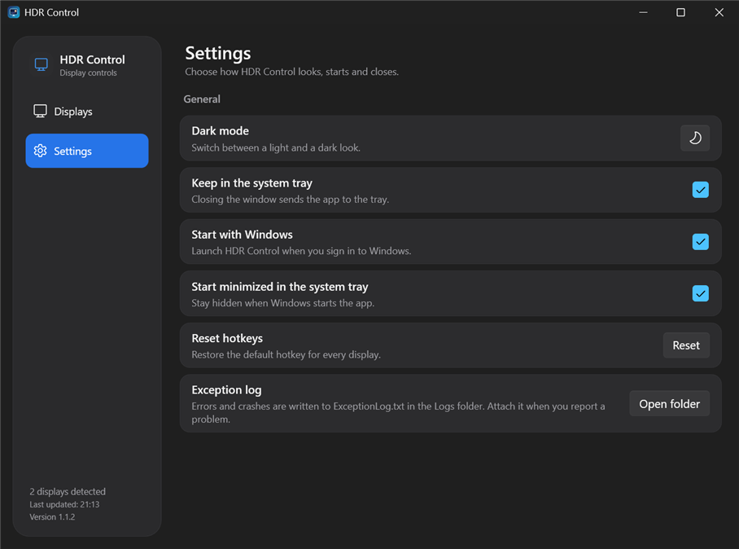

<p align="center">
  
</p>

<h1 align="center">HDR Control</h1>

<p align="center">
  <b>Switch HDR on or off for one display or all of them, with a click or a global hotkey.</b><br>
  A small, open-source Windows tray app that talks to the Windows display APIs directly.
</p>

<p align="center">
  
  
  
</p>

<p align="center">
  
</p>

## What is it?

Windows hides the HDR switch deep in Settings, and it has no hotkey. With several monitors you
flip it again and again: on for the game, off for the desktop. HDR Control fixes that:

- **See** at a glance which display runs HDR and which does not.
- **Switch** one display, or all HDR-capable displays together, with one click.
- **Use a hotkey** that works from anywhere, even when the app only lives in the system tray.

It is a single `.exe`, needs no installer, and changes apply immediately.

> The screenshot above shows two displays: the first has HDR on (blue tile and switch), the second is in SDR.
> Blue always means HDR is on; everything else is neutral graphite (dark) or paper (light).

## Features

| | |
|---|---|
| **One tile per display** | Each display is drawn as a monitor that says **HDR**, **SDR** or **n/a** in large type, with its name, hotkey and switch. The page scrolls when you have many displays. |
| **All displays** | The switch in the top bar turns HDR on for every supported display if at least one is off, otherwise it turns HDR off. |
| **Global hotkeys** | Defaults are `Ctrl+Alt+1`, `Ctrl+Alt+2`, … per display and `Ctrl+Alt+0` for all. Click a hotkey field, press a modifier plus a key; Backspace clears it. A hotkey that another display already uses is rejected. |
| **Reset hotkeys** | One button in Settings restores the defaults. Displays you unplug keep their hotkey and get it back when you reconnect them. |
| **System tray** | Closing the window either asks what to do or goes straight to the tray, as you choose. The tray menu has *Open HDR Control* and *Quit*; the icon comes back after an Explorer restart. |
| **Start with Windows** | Optional, per Windows user. Can start minimized to the tray. Starting the app again brings the running window to the front. |
| **Toasts and tray notices** | Results appear as a short notice in the window. When a hotkey fires while the window is hidden, a quiet Windows notification tells you what happened. |
| **Light and dark theme** | Switch with the sun/moon button in Settings; the choice is saved. High contrast mode is respected. |
| **Live refresh** | The list updates itself when you plug, unplug or reconfigure a display, and before every hotkey, so it also notices HDR changes made in Windows Settings. |
| **Exception log** | Errors and crashes go to `%LocalAppData%\HDRControl\Logs\ExceptionLog.txt`; Settings opens the folder. |

## Quick tour

1. Start `HDRControl.exe`. Active displays appear as tiles; displays without HDR support stay visible, dimmed, with a disabled switch.
2. **Switch a display:** use the switch under its tile, or press its hotkey.
3. **Switch everything:** use the switch in the top bar, or press `Ctrl+Alt+0`.
4. **Change a hotkey:** click the field, press the new combination.
5. **Run in the background:** in *Settings*, turn on *Keep in the system tray* and *Start with Windows*.

<table>
  <tr>
    <td width="50%" align="center"><br><sub>Displays, light theme</sub></td>
    <td width="50%" align="center"><br><sub>Settings, dark theme</sub></td>
  </tr>
</table>

## How it works

HDR Control is a normal user-mode app, no driver and no separate CLI.

1. **Find displays:** it asks Windows for the active display paths (`QueryDisplayConfig`) and identifies each display by its
   device path, so hotkeys survive reboots and re-plugging.
2. **Read and set HDR:** it uses `DisplayConfigGetDeviceInfo` and `DisplayConfigSetDeviceInfo`. On current Windows it sets
   the HDR state with the newer API, otherwise with the legacy advanced-color call.
3. **Hotkeys:** registered with `RegisterHotKey` on the window, so they work while the app only runs in the tray.
4. **Stay current:** a `WM_DISPLAYCHANGE` message restarts a short timer and then refreshes the list.

## Requirements

- Windows 10 or 11, 64-bit, with at least one HDR-capable display.
- To build from source: the [.NET 10 SDK](https://dotnet.microsoft.com/download).

## Build from source

```powershell
git clone https://github.com/Kurosaki22/HDRControl.git
cd HDRControl

dotnet build .\HDRControl.Tests\HDRControl.Tests.csproj
dotnet test  .\HDRControl.Tests\HDRControl.Tests.csproj

# One self-contained file with the .NET and WPF runtimes bundled in:
dotnet publish .\HDRControl.App\HDRControl.App.csproj -c Release
```

The executable is written to `HDRControl.App\bin\Release\net10.0-windows\win-x64\publish\HDRControl.exe`.
The first launch extracts native runtime components to a temporary directory.
Settings are stored in `%LocalAppData%\HDRControl\settings.json`.

The tests start the real executable and drive it through UI Automation. Quit a running HDR Control first, and do not
type while they run.

## Releases

Every pull request merged into `main` raises the patch version of the latest `v*` tag
(for example `v1.1.3` → `v1.1.4`), runs the tests, builds the executable and publishes it as a GitHub release.

## Good to know

- **Unsupported displays** stay in the list, dimmed, and cannot be switched.
- **Settings file:** if `settings.json` is damaged, it is moved to `settings.json.bak` and the app starts with defaults.
  If it is locked by another program, the app starts with defaults and does not save until the next start.
- **Autostart repair:** if the startup entry points to an executable that no longer exists, the app rewrites it to itself.
- **Two displays with the same target ID on different graphics cards** cannot be told apart when old settings are migrated.
- **SmartScreen:** the executable is not code-signed, so Windows may show a warning on first run.

## Project layout

| Path | What |
|---|---|
| `HDRControl.App` | WPF app: window, view model, display, hotkey, tray and startup services, themes |
| `HDRControl.App/Themes` | Light and dark colour palettes |
| `HDRControl.Tests` | UI tests that run the real executable |
| `screenshots` | The images above |

## Ideas for later

Command line (`--hdr on|off|toggle`) · automatic HDR while a chosen program runs · HDR switches in the tray menu ·
update notice.

## License

[Unlicense](LICENSE.txt) (public domain).
