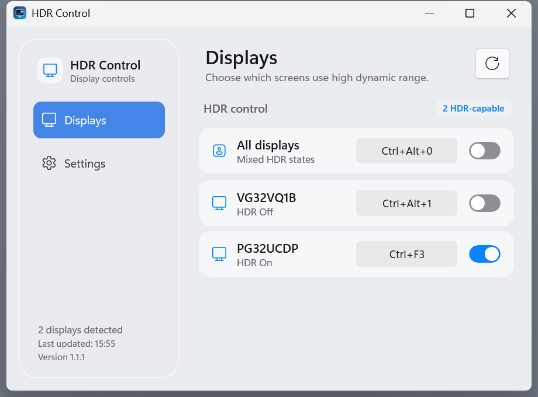
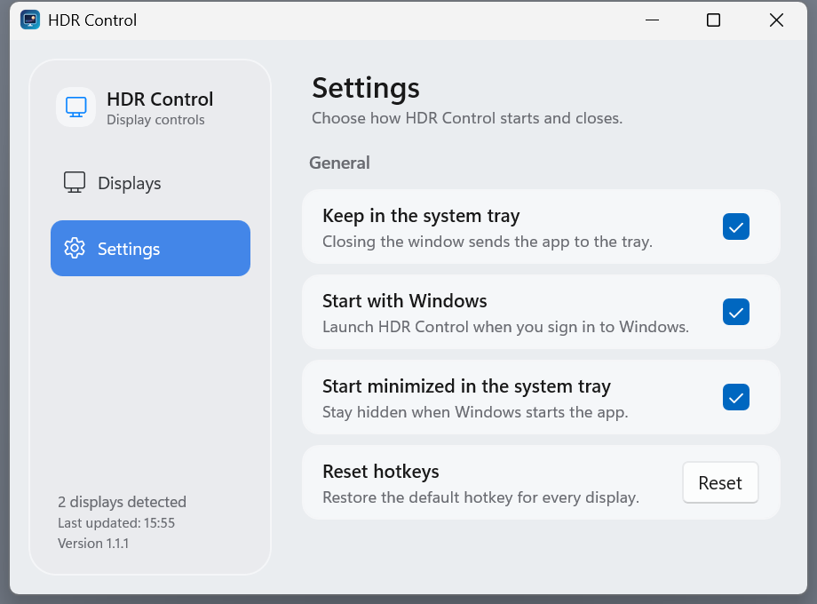

# HDR Control

HDR control for Windows displays with a compact, light C# WinUI 3 interface.
Active displays are detected automatically; HDR is controlled directly through
the Windows DisplayConfig APIs, without a separate CLI.

## Screenshots

| Displays | Settings |
|:--:|:--:|
|  |  |

## Features

- View each active display's name and HDR status.
- Turn HDR on or off with the pill switch beside each display, or synchronize
  all HDR-capable displays with the All displays switch.
- Refresh the display list and status on demand.
- Unsupported displays remain visible, but their switches are disabled.
- Assign system-wide shortcuts to individual displays and all displays. The
  defaults are `Ctrl+Alt+1`, `Ctrl+Alt+2`, and so on, with `Ctrl+Alt+0` for all.
- Choose whether closing the window sends the app directly to the system tray
  or asks what to do.
- Choose whether HDR Control starts automatically when you sign in to Windows.
- A fixed-size, light macOS System Settings-inspired sidebar with translucent
  acrylic surfaces and compact display rows.
- Set each display's shortcut and the all-displays shortcut on the Displays
  page; Settings contains the system-tray preference.
- Publish a self-contained, single-file Windows executable.
- A custom HDR Control icon is embedded in the app and system tray.

Shortcut assignments are saved under `%LocalAppData%\HDRControl\settings.json`.
Set a monitor shortcut or the all-displays shortcut on the Displays page by
clicking its field and pressing a modifier plus a key. Press Backspace to clear
a shortcut. If at least one supported display has HDR off, the all-displays
action turns HDR on for every supported display; otherwise it turns HDR off.

Enable “Keep in the system tray” in Settings to hide the window directly on
close without a prompt. When disabled, closing the window asks whether to quit,
stay open, or move to the system tray. Use the tray icon's context menu to
reopen the app or quit it. Enable “Start with Windows” in Settings to register
the current executable for startup for your Windows user.

## Publish a single executable

Requires the .NET 10 SDK and Windows SDK 10.0.26100 or later.

```powershell
dotnet publish .\HDRControl.App\HDRControl.App.csproj -c Release
```

The self-contained x64 executable is written to:

`HDRControl.App\bin\Release\net10.0-windows10.0.26100.0\win-x64\publish\HDRControl.exe`

The Windows App SDK runtime and .NET runtime are bundled in the executable.
The first launch extracts native runtime components to a temporary directory.
