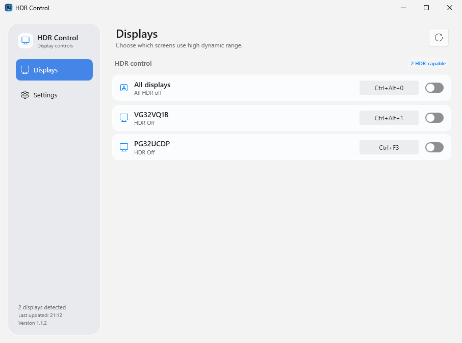
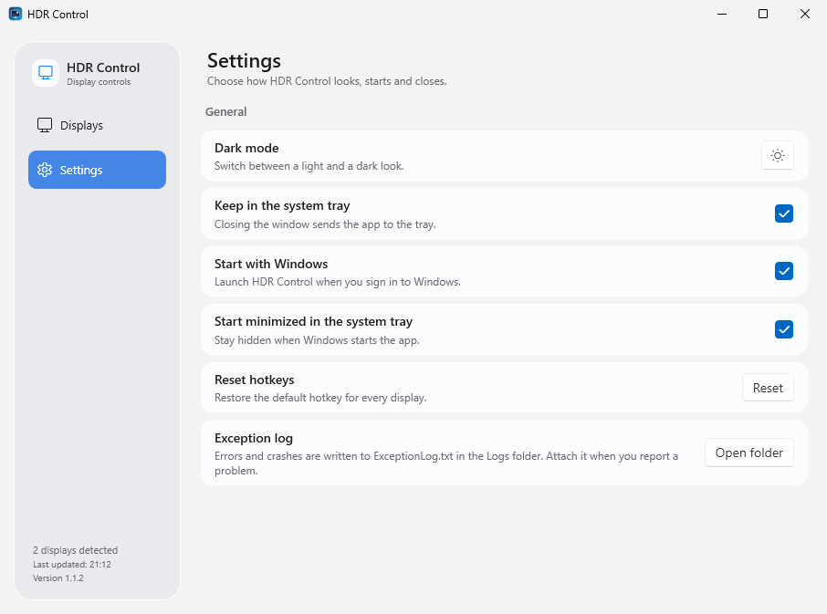

# HDR Control

HDR control for Windows displays with a compact, light C# WPF interface.
Active displays are detected automatically; HDR is controlled directly through
the Windows DisplayConfig APIs, without a separate CLI.

## Screenshots

| Displays | Settings |
|:--:|:--:|
|  |  |

## Features

- View each active display's name and HDR status.
- Turn HDR on or off with the pill switch beside each display, or synchronize
  all HDR-capable displays with the All displays switch.
- Refresh the display list and status on demand.
- Unsupported displays remain visible, but their switches are disabled.
- Assign system-wide hotkeys to individual displays and all displays. The
  defaults are `Ctrl+Alt+1`, `Ctrl+Alt+2`, and so on, with `Ctrl+Alt+0` for all.
- Choose whether closing the window sends the app directly to the system tray
  or asks what to do.
- Choose whether HDR Control starts automatically when you sign in to Windows,
  and whether that automatic start stays minimized in the system tray.
- Starting the app again brings the running instance to the front.
- A sidebar layout with compact display rows, in a light or dark theme. Switch
  it with the sun/moon button under "Dark mode" in Settings; the choice is saved.
- Renders cleanly when the window moves between monitors with different
  scaling or on different graphics cards.
- Errors and crashes are logged to
  `%LocalAppData%\HDRControl\Logs\ExceptionLog.txt`; Settings opens the folder.
- Set each display's hotkey and the all-displays hotkey on the Displays
  page; Settings contains the system-tray preference.
- Publish a self-contained, single-file Windows executable.
- A custom HDR Control icon is embedded in the app and system tray.

Hotkey assignments are saved under `%LocalAppData%\HDRControl\settings.json`.
Set a monitor hotkey or the all-displays hotkey on the Displays page by
clicking its field and pressing a modifier plus a key. Press Backspace to clear
a hotkey. A hotkey that is already used by another display is rejected
and the previous one stays. “Reset hotkeys” in Settings restores the defaults.
If at least one supported display has HDR off, the all-displays
action turns HDR on for every supported display; otherwise it turns HDR off.

Enable “Keep in the system tray” in Settings to hide the window directly on
close without a prompt. When disabled, closing the window asks whether to quit,
stay open, or move to the system tray. Use the tray icon's context menu to
reopen the app or quit it. Enable “Start with Windows” in Settings to register
the current executable for startup for your Windows user. Enable “Start
minimized in the system tray” to keep the window hidden on that automatic start;
starting the app yourself always shows the window.

## Publish a single executable

Requires the .NET 10 SDK.

```powershell
dotnet publish .\HDRControl.App\HDRControl.App.csproj -c Release
```

The self-contained x64 executable is written to:

`HDRControl.App\bin\Release\net10.0-windows\win-x64\publish\HDRControl.exe`

The .NET and WPF runtimes are bundled in the executable.
The first launch extracts native runtime components to a temporary directory.

## Releases

Every pull request merged into `main` raises the patch version of the latest
`v*` tag (for example `v1.1.3` → `v1.1.4`), builds the executable and publishes
it as a GitHub release.
